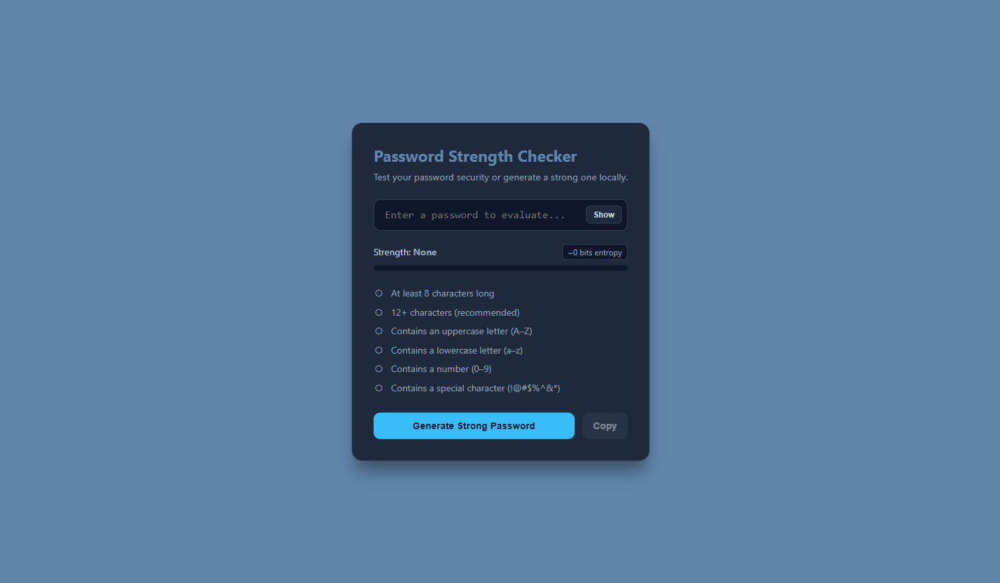
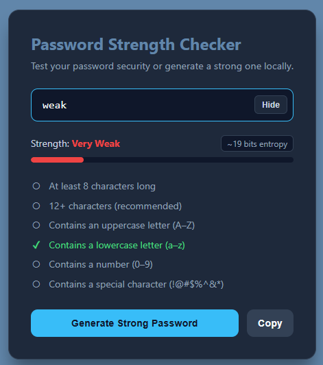
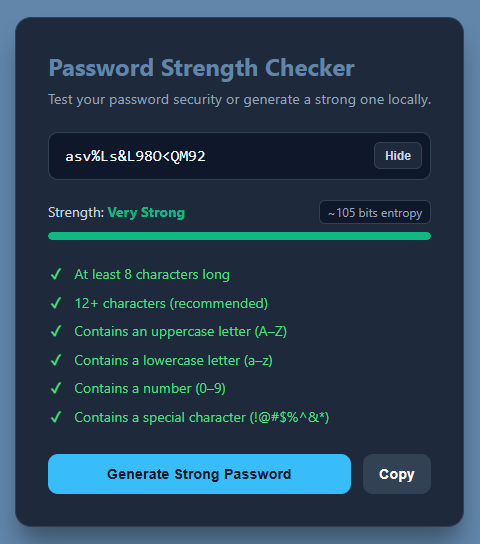

# Password Check

A real-time, browser-based password strength checker and random password generator, built with React and Vite.

Project by Niam Swargari, Bhoomika Mishra and Khushboo Kumari (B.Tech Computer Science Engineering, Semester 5, IILM University, Gurugram).

## Features

- Rates a password from **Very Weak** to **Very Strong** on every keypress, without reloading the page
- Shows a checklist of six criteria and an entropy estimate in bits
- **Show / Hide** toggle for the password field
- **Generate Strong Password** button that fills the field with a random 16-character password
- **Copy** button to copy the password to the clipboard
- Everything runs in the browser; the source contains no network calls

## Screenshots

### The app


### Weak password


### Strong password


## Getting started

You need [Node.js](https://nodejs.org/) and npm installed.

```bash
git clone https://github.com/niamswargari/Password-Check.git
cd "C:\Users\Niam\Desktop\Password Check\Password Check"
npm install
npm run dev
```

Then open the local address that Vite prints in the terminal (usually http://localhost:5173).

Other commands:

| Command | What it does |
|---|---|
| `npm run build` | Creates a production build in `dist/` |
| `npm run preview` | Serves the production build locally |
| `npm run lint` | Runs ESLint on the source |

## How strength is calculated

The app tests the password against six criteria:

1. At least 8 characters
2. At least 12 characters
3. Contains an uppercase letter
4. Contains a lowercase letter
5. Contains a number
6. Contains a special character

The number of criteria passed sets the rating:

| Criteria passed | Rating |
|---|---|
| 0 to 2 | Very Weak |
| 3 | Weak |
| 4 | Fair |
| 5 | Strong |
| 6 | Very Strong |

The entropy estimate is `length × log2(character pool size)`, where the pool adds 26 for lowercase letters, 26 for uppercase letters, 10 for digits and 32 for other characters.

## Privacy

Passwords are processed locally in your browser and held only in memory. The source code contains no network calls and does not use `localStorage` or `sessionStorage`. The Copy button places the password on your clipboard, so clear it afterwards if you are on a shared computer.

## Testing

`tools/benchmark.mjs` runs the app's own scoring and generator code from `src/App.jsx` on a set of test passwords and prints the ratings, entropy values and timings:

```bash
cd "Password Check"
node tools/benchmark.mjs
```

## Known limitations

- The rating counts character types and length. It does not detect common words, keyboard runs, sequences or dates, so a predictable password such as `Password1!` is rated **Strong**.
- The entropy figure is a character-pool estimate, not a measure of how hard a password is to guess, and it overstates the strength of human-chosen passwords.
- There is no time-to-crack estimate.
- The generator uses `Math.random()`, which is not a cryptographically secure source. Do not use generated passwords for important accounts until it is replaced with `crypto.getRandomValues()`.

## Planned work

- Pattern detection for dictionary words, keyboard runs, sequences, repeats and dates
- A time-to-crack estimate
- A cryptographically secure generator using `crypto.getRandomValues()`

## Tech stack

HTML, CSS, JavaScript, React 19, Vite 8, ESLint

## Repository layout

```
Password Check/
├── src/            React app (App.jsx holds the scoring and generator)
├── docs/           Screenshots used in this README
├── tools/          benchmark.mjs test script
├── public/         Static assets
├── script.js       Earlier plain-JavaScript prototype (not used by the app)
└── style.css       Styles for the earlier prototype (not used by the app)
```
